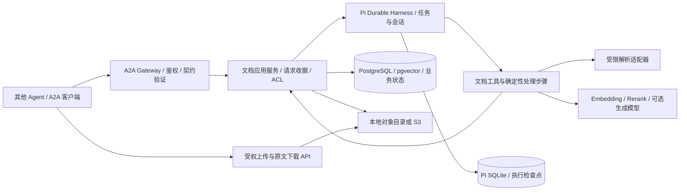

# 产品边界与架构

日期：2026-10-16。本文中的模块、数据库表、路径和预算均为**待实施设计**；来源事实见 01、02、04。

## 1. 用户场景与完成定义

调用方可以是任意实现兼容 A2A 的 Agent。它发现本服务的 Agent Card，使用自己的服务身份，发送结构化业务操作或自然语言任务，获取持久化任务 ID，然后取得结果或继续补充资料。调用方不需要知道 Pi 的内部 API，也无需启动 WeKnora。

| 场景 | 输入 | 对调用方有意义的成功 |
|---|---|---|
| 保存研究资料 | Markdown/文本、已上传文件、允许访问的 URL | 获得 documentId、version、校验和、indexState；默认等待到可检索才 completed |
| 查找依据 | 问题、知识库、标签/文档过滤 | 返回排序片段、原文位置、版本和受权来源链接；无命中返回空数组 |
| 读取资料 | documentId 与可选 version | 返回原文或分页内容及来源，不依赖模型重写 |
| 更新资料 | documentId、expectedVersion、新内容 | 新版成功发布后替换当前检索版本；并发冲突有明确错误 |
| 删除资料 | documentId、expectedVersion | 立即从访问与检索中隐藏；物理清理状态可追踪 |
| 有依据回答（P1） | 问题 | 每个事实引用可核验片段；资料不足明确返回证据不足 |

“保存完成”分开表达：原文件已存储、解析完成、索引发布。P0 默认 `waitFor=indexed`，只能在发布提交完成后 A2A completed。选择 `waitFor=stored` 时只承诺落盘，结果必须带 ingestionTaskId（公共A2A索引任务ID，可用GetTask/CancelTask）和非 ready 的 indexState，索引由独立持久化任务继续执行。

## 2. 范围与默认假设

- P0 面向少量内部可信 Agent；同时强制服务端鉴权、知识库隔离和审计。部署默认绑定 loopback，远程部署再加 TLS 与网络边界。
- 服务逻辑本身支持多身份、多知识库；不因“先本机用”而把租户标识交给模型决定。
- P0 支持 UTF-8 TXT、Markdown、文本型 PDF、DOCX、公开 HTML URL。扫描 PDF/OCR、图片、复杂表格列为 P1；暂不支持的格式要失败并说明原因。
- 先做服务与最小运维入口，完整 Web 界面分阶段复刻。微信/IM、通用 coding agent、沙箱、浏览器控制不是文档核心闭环前置条件。
- 模型供应商、Embedding 模型和维度在 M0 根据实际可用环境锁定；不继承其他项目的密钥、预算或产品模型配置。

## 3. 组件与唯一职责

### 推荐技术栈

| 层 | 方案 | 原因与约束 |
|---|---|---|
| 服务/Agent | TypeScript、支持 Pi 要求的 Node LTS、Pi Durable 精确版本 | 共用类型和工具合同；禁止通过浮动范围无意升级实验 API |
| A2A | 官方兼容 SDK + 小适配层 | 合同版本与 SDK 的实际支持配对，见 04；领域层不依赖 wire 格式 |
| 业务存储 | PostgreSQL + pgvector | 元数据、版本、ACL、词法与向量结果可在同一数据库内原子发布 |
| Agent 执行存储 | Pi 官方 SQLite adapter，持久卷 | 复用已有恢复能力；单写者进程，不把 SQLite 文件放在共享网络盘 |
| 原文件 | 本地内容寻址目录；接口支持 S3 compatible | 本机最小依赖；大对象不塞进会话或 JSON 文档 |
| 文档解析 | Parser 接口，TXT/MD原生；PDF/DOCX隔离适配器 | 借鉴 WeKnora 解析格式和溯源结构；不需要迁移整套 Go 服务 |
| 词法检索 | 预分词后 PostgreSQL tsvector | 中文必须显式分词并保留原偏移；不假设默认英语配置能处理中文 |
| 向量检索 | pgvector cosine 距离 + 模型版本隔离 | Embedding 模型变更必须重建 generation，不能混合向量空间 |
| 排序 | RRF 融合；可配置独立 Reranker | 原始向量/全文分数不直接相加；失败时标明降级 |

不引入 Redis 任务队列作为第二个执行调度器；Pi 调度任务，PostgreSQL 仅保留业务收据、阶段结果及待投递 outbox。也不导入 RSI 的自进化、工厂、独立 worker 编排等控制面。

### Pi 的实际位置

结构化操作经过鉴权后由 Pi 持久化任务执行应用服务；不必为简单保存/list/get强制调用 LLM。自然语言请求由 Pi Conversation 使用选定文档工具完成，并调用同一应用服务。两条路径都必须经过真实 Pi 持久化与恢复测试，不能把 Pi 仅作为未使用依赖。

注册工具拟定为 `knowledge_base_create/list`、`document_save/search/get/list/update/delete`；P1 加 `document_answer`。自然语言工具写入权限来自服务端 RequestContext，禁止参数自行指定或提升主体。`document.delete` 需要专用 write/delete scope；模糊删除先返回缺失范围，不由模型扩展到全库。

上传与下载是 A2A 的辅助数据平面：授权令牌、大小限额、短期 uploadId、校验和、过期回收。服务禁止把调用方文件路径作为本地任意读文件能力。

## 4. 身份、任务与资源

| 标识 | 生命周期与边界 |
|---|---|
| principalId / tenantId | 从服务端令牌认证映射；客户端 DataPart 内同名字段不作为身份来源 |
| knowledgeBaseId | ACL 资源边界；所有查、写、流订阅、引用下载都需重新鉴权 |
| A2A contextId | 外部交互上下文；先持久化绑定主体，再映射 Pi conversationId |
| A2A taskId | 对外业务任务；不等于 Pi 内部 taskId，也不等于文档 ID |
| requestId | 调用方业务幂等键；按 tenant + principal + operation 作用域与 payloadHash 检查 |
| messageId / JSON-RPC id | 协议消息/传输关联；不能替代业务幂等 |
| Pi conversationId / submissionId / taskId | 执行身份，通过服务端映射恢复；不暴露 SQLite 或模型上下文 |
| documentId / version / generationId | 逻辑资料、不可变内容版本、某次解析与索引配置产物 |

不允许一个全局 Pi root 会话混装不同租户资料。每个经授权的 A2A context 使用自己的 Conversation；无 contextId 的新操作由服务端建上下文。并发请求使用版本冲突和队列语义控制，禁止覆盖正在执行的输入。

## 5. 权限与不可信资料

P0 scope：`knowledge:read`、`knowledge:write`、`knowledge:delete`、`knowledge:admin`，另有允许知识库集合。既过滤检索候选，也在输出、引用和下载处复核 ACL。拒绝不返回其他租户的资源标题、片段或存在性。A2A任务另记录resourceRefs；GetTask/ListTasks/SubscribeToTask以及历史Artifact读取同时检查task owner和当前所引用KB/文档权限，撤权后整体返回不可见，不因结果已缓存而继续提供正文。对外history默认不包含Pi内部模型上下文、系统指令和工具日志。

文档、网页、解析器输出均视为数据，不能改变系统指令、工具白名单或网络权限。Pi 工具列表不提供任意 shell；解析器限制 CPU、内存、时间和网络，默认不执行宏。URL fetch 校验每次重定向及最终 DNS/IP，拒绝 localhost、私网、link-local/云元数据、file/data协议，控制下载体积与解压比。企业内网源若要使用，在 P2 以独立受权连接器实现。

日志记录 requestId/taskId/documentId/version、阶段耗时、模型与索引版本、错误类别和审计事件，不默认记录全文或令牌。TLS、令牌轮换、速率和大小限制均是远程使用的上线门槛。

## 6. 部署、备份与扩容边界

P0 一个 Node 进程拥有一个 Pi SQLite，PostgreSQL 与 blob 目录使用持久卷。崩溃后同一实例打开原存储并恢复，服务需先就绪再接收流量。目标恢复时间写入验收。

备份须暂停新写入、让执行步骤进入检查点、保存 PG 一致性快照/Pi SQLite 一致性备份/blob manifest，并记录同一 backupId；恢复后先运行 reconciliation 再开放服务。仅备份 SQLite 或仅备份向量均不算恢复方案。

P1 可分离 parser 并增加受限并行；多 Node 实例不能同时打开同一个 Pi SQLite。真正横向扩展在 P2 设计按 tenant/session 分片、唯一 owner lease 与 fencing 后再做。P0 不承诺高可用。
